<!-- Sana Shahid · GitHub profile. Panels are rendered from the sanashahid.me brand kit (Shantell Sans, Eureka / Pathfinder / Empower on Navy and Ivory). -->

  <a href="https://sanashahid.me">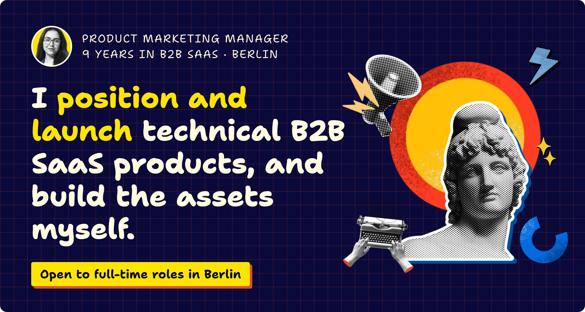</a>

  <a href="https://sanashahid.me/portfolio">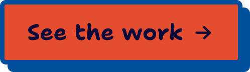</a>&nbsp;
  <a href="https://sanashahid.me/resume">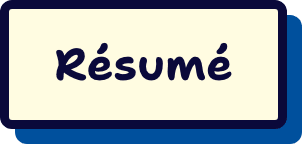</a>&nbsp;
  &nbsp;
  <a href="https://x.com/isanashahid">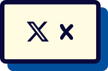</a>&nbsp;
  

 

  <a href="https://sanashahid.me/portfolio">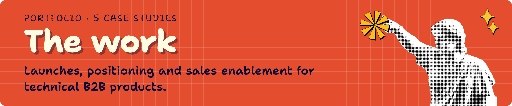</a>

  <a href="https://sanashahid.me/portfolio/trustyou-cdp">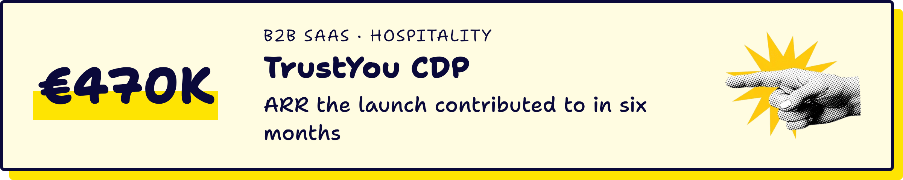</a>
  <a href="https://sanashahid.me/portfolio/lexisnexis-iplytics">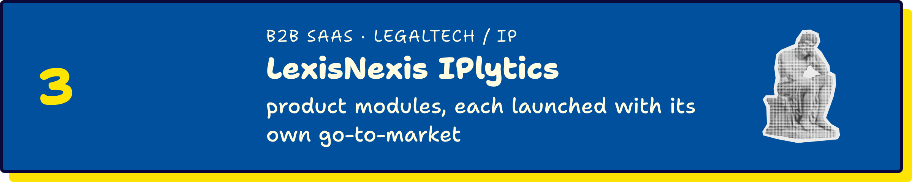</a>
  <a href="https://sanashahid.me/portfolio/invisible-edge">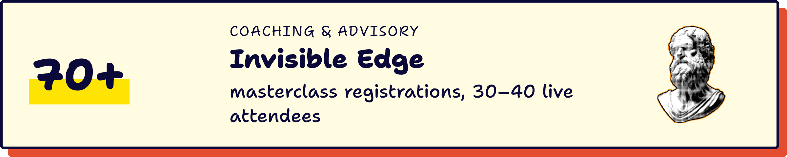</a>
  <a href="https://sanashahid.me/portfolio/acceo-smart-vendor-pos">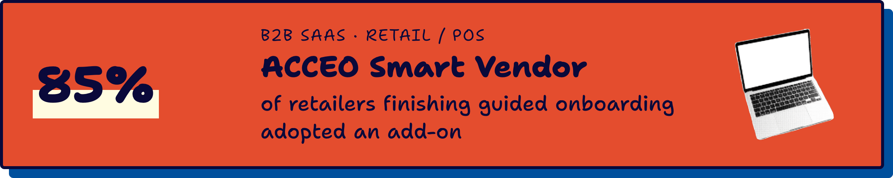</a>
  <a href="https://sanashahid.me/portfolio/tcl-sunpower-catalog-2025">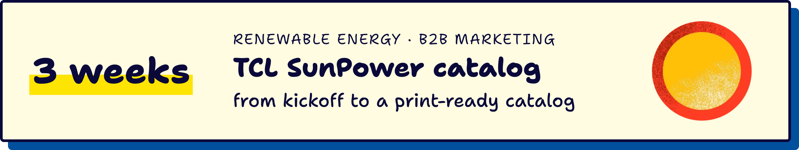</a>

 

  <a href="https://sanashahid.me/lab">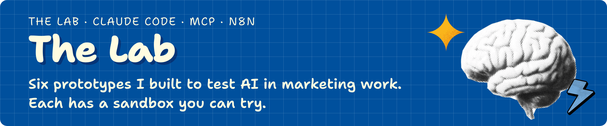</a>

  <a href="https://sanashahid.me/lab/agentic-campaign-ops">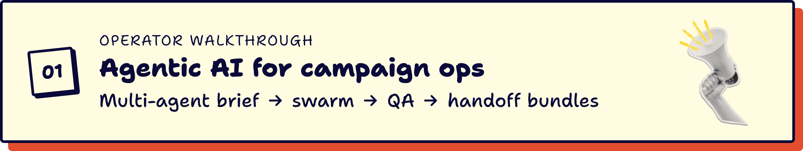</a>
  <a href="https://sanashahid.me/lab/prompt-library-marketing">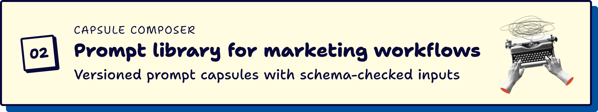</a>
  <a href="https://sanashahid.me/lab/voc-automation-n8n">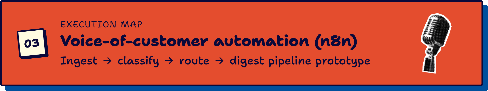</a>
  <a href="https://sanashahid.me/lab/gamified-marketing-funnel">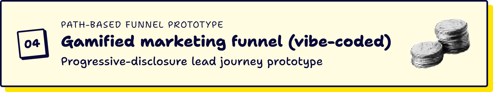</a>
  <a href="https://sanashahid.me/lab/collateral-coherence-studio">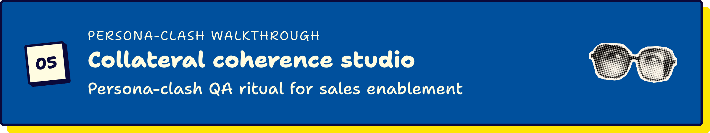</a>
  <a href="https://sanashahid.me/lab/triple-room-module-composer">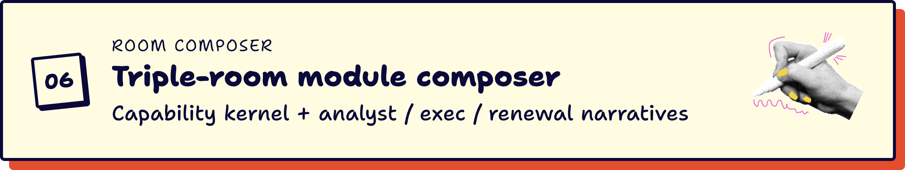</a>

 

  <a href="https://sanashahid.me/notes">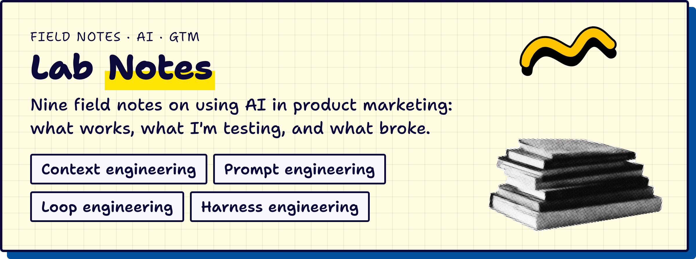</a>

  <a href="https://sanashahid.me/chat">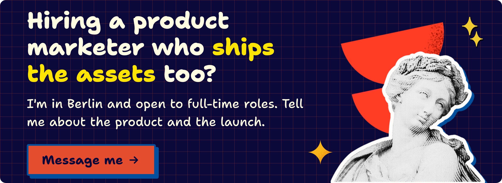</a>

  <a href="https://sanashahid.me">sanashahid.me</a> ·
  <a href="https://sanashahid.me/portfolio">Portfolio</a> ·
  <a href="https://sanashahid.me/lab">The Lab</a> ·
  <a href="https://sanashahid.me/notes">Lab Notes</a> ·
  <a href="https://sanashahid.me/resume">Résumé</a> ·
  <a href="https://www.linkedin.com/in/isanashahid/">LinkedIn</a> ·
  <a href="https://x.com/isanashahid">X</a>

